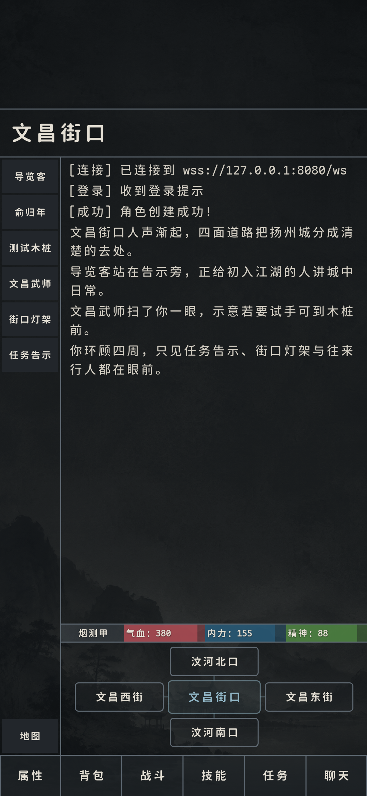
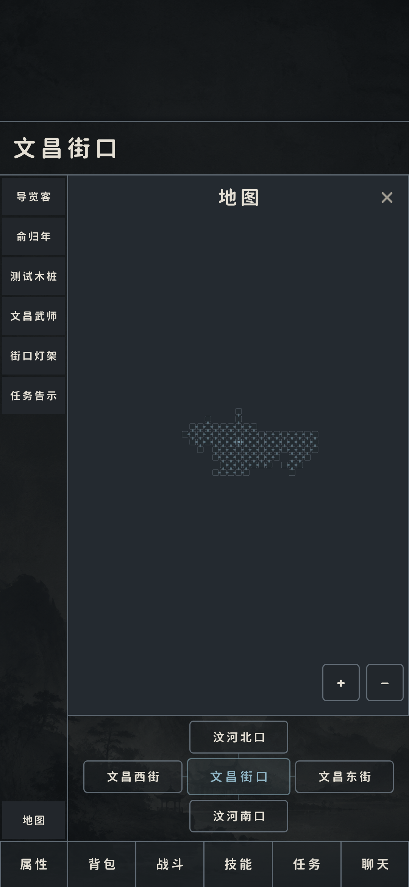
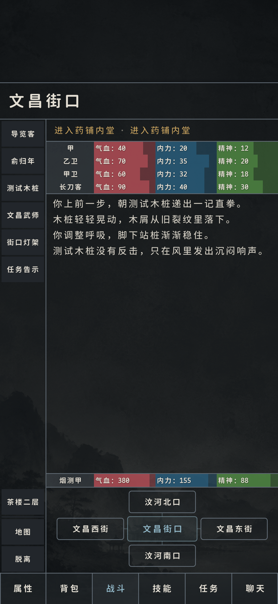
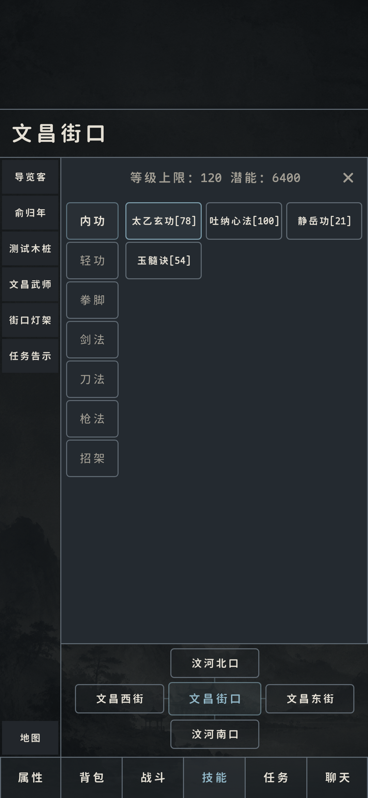
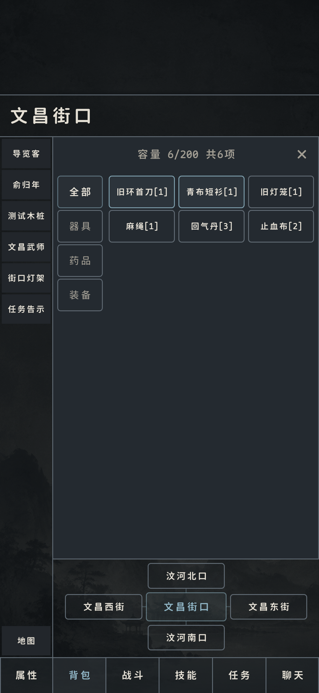

# 侠客行 · XiaKeXing

[](https://github.com/FengYunCalm/xiakexing-public)

侠客行是一款中文文字武侠网络游戏项目，结合 LPC 游戏服务端、Go Gateway 和 Android 客户端。这个仓库用于求职和技术评审，展示 `main` 分支的代表性代码与客户端界面。

> 这是面向求职和技术评审整理的 `main` 代码展示快照。

## 项目结构

```text
client/       Android 客户端生产代码与界面资源
gateway-go/    Go Gateway 生产代码
server/       LPC 服务端运行时、游戏服务和玩家命令代码
showcase/     客户端界面展示图（位于 `showcase/screenshots/`）
```

仓库按代码审阅场景组织目录，源码与界面素材分别放在对应模块中。

## 值得查看的部分

### Android 客户端

客户端使用 Kotlin、Jetpack Compose 和模块化结构实现。可以重点查看：

- `client/feature/shell/src/main/`：主游戏界面、面板、交互编排和状态渲染；
- `client/core/`：客户端网络、协议和本地存储模块；
- `client/app/src/main/`：应用入口、主题和窗口控制；
- `showcase/screenshots/`：当前客户端界面截图。

### Go Gateway

`gateway-go/` 展示 Gateway 的连接管理、帧处理、会话、顺序交付和服务入口代码。

### LPC 服务端

`server/` 展示 Driver 之上的游戏运行时、服务对象、玩家命令和游戏服务实现。

## 本地查看

建议先从 `client/feature/shell/src/main/`、`gateway-go/` 和 `server/` 阅读，再结合 `showcase/screenshots/` 查看界面。

如需构建 Android 客户端：

```bash
cd client
./gradlew assembleDebug
```

## 界面展示

| 主界面 | 地图 |
| --- | --- |
|  |  |

| 战斗界面 | 技能 |
| --- | --- |
|  |  |

| 背包 |
| --- |
|  |

## 技术栈

- **客户端**：Kotlin、Jetpack Compose、Android Gradle Plugin
- **Gateway**：Go
- **游戏服务端**：LPC / FluffOS Driver
- **协议**：客户端、Gateway 与游戏服务端之间的分层消息协议

## 说明

- 当前仓库是人工整理的展示快照，后续更新以公开仓库提交为准。
- 代码与界面素材按模块组织，便于快速浏览。

## License

本项目采用 `XK-NC-AGPL-1.0`（GNU Affero General Public License v3.0 + 非商业限制）。

- 允许个人、教育、研究和其他非商业使用。
- 禁止商业使用，包括销售、付费托管、广告变现和付费服务。
- 分发修改版、衍生作品或通过网络提供服务时，必须在同一协议下公开对应完整源代码。
- 商业授权请联系版权持有人。
